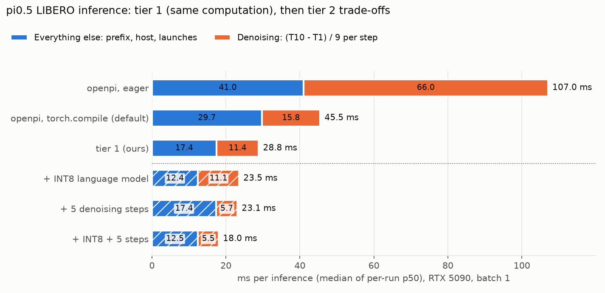
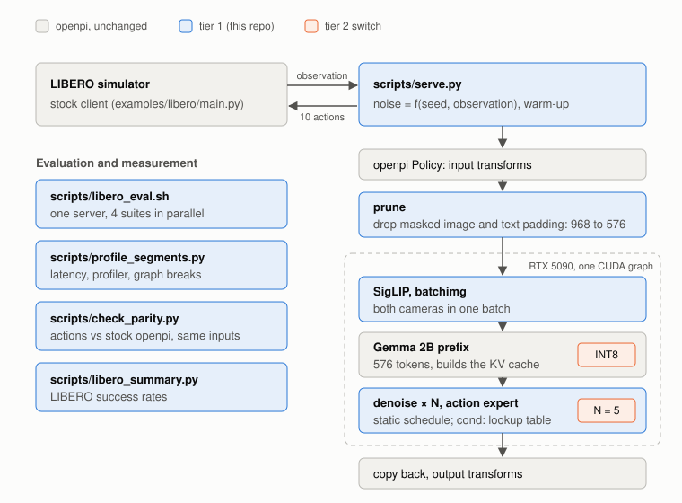

# pi05-libero-inference-acceleration

**π0.5 机器人策略模型的推理剖析与加速（openpi PyTorch，RTX 5090）**

*Profiling and accelerating one inference of the public π0.5 LIBERO policy (openpi, PyTorch) on a single RTX 5090: from 45.5 to 28.8 ms with computation-preserving changes (padding pruning, a graph-break-free fixed schedule, precomputed timestep conditioning, batched cameras), and 18.0 ms with INT8 and fewer denoising steps as separate engineering trade-offs; outputs checked against stock openpi and on LIBERO.*

在单张 RTX 5090 (32 GB) 上剖析公开的 π0.5 LIBERO 模型（[openpi](https://github.com/Physical-Intelligence/openpi) 官方 PyTorch 实现）一次推理的耗时，找到瓶颈并加速。结果分两层：

- **第一层：计算语义不变的优化。** 不改 openpi 源码，四项改动把一次推理（`Policy.infer`，batch 1，openpi 默认的 `torch.compile`）从 **45.47 ms 降到 28.84 ms（−36.6%）**，显存峰值从 7.11 降到 6.65 GiB。动作输出与原版的差异比 openpi 自己“编译 vs 不编译”的差异还小；LIBERO 成功率 96.5%，原版 96.8%。
- **第二层：进一步的工程取舍。** 在第一层之上，INT8 量化语言模型到 23.52 ms，去噪从 10 步减到 5 步后为 23.07 ms，两者叠加到 **18.01 ms（原版的 40%）**，LIBERO 成功率 96.7–97.1%。



| 每次推理（batch 1） | 端到端 p50 | p95 | GPU 实际计算 | 显存峰值 | 动作偏差 vs 原版编译（手臂平均 / 最大） | LIBERO 成功率 |
|---|---|---|---|---|---|---|
| openpi，不编译 | 107.04 ms | 108.00 | 62.91 ms | 7.12 GiB | 0.00080 / 0.043 | – |
| openpi，`torch.compile`（默认） | 45.47 ms | 45.76 | 40.76 ms | 7.11 GiB | – | 96.8% |
| **第一层：裁剪 + 固定步数 + 预计算条件 + 相机批处理** | **28.84 ms** | 28.98 | 25.65 ms | 6.65 GiB | 0.00041 / 0.019 | 96.5% |
| 第二层：+ INT8 语言模型 | 23.52 ms | 23.76 | 19.09 ms | 4.87 GiB | 0.00269 / 0.065 | 97.1% |
| 第二层：+ 去噪 5 步 | 23.07 ms | 23.31 | 20.49 ms | 6.65 GiB | 0.00454 / 0.138 | 96.7% |
| 第二层：+ INT8 + 去噪 5 步 | **18.01 ms** | 18.15 | 14.08 ms | 4.84 GiB | 0.00524 / 0.150 | 97.0% |
| openpi JAX 实现（参照，XLA jit） | 59.5 ms | | | | 0.00089 / 0.087 | – |

- 端到端：`Policy.infer` 从收到观测到返回动作的墙钟时间，含 openpi 的输入输出变换和主机与 GPU 之间的拷贝，不含 websocket 和仿真。每种配置 3 轮 × 100 次，p50 取三轮各自 p50 的中位数，p95 是合并 300 次的分位数；用 200 个真实 LIBERO 观测循环计时结果接近（原版 45.51、第一层 28.86 ms）。
- GPU 实际计算：torch.profiler 记录的 kernel 执行时间（不含拷贝），单独一轮开 profiler 测得。显存峰值：`torch.cuda.max_memory_allocated()`。
- 动作偏差：200 个真实 LIBERO 观测 × 3 份噪声，与原版编译用相同噪声比较输出的 10 步 × 7 维动作；手臂 6 维的平均幅值是 0.158。夹爪方向一致率 99.92–100%。数据：[`results/parity/`](results/parity/)（汇总 JSON 与原始动作 `.npz`）。
- LIBERO：4 个套件 × 10 个任务 × 50 个固定初始状态，每次 2000 个 episode；各配置用相同的初始状态，服务端噪声按观测内容生成。每个配置评测 3 次（服务端噪声种子 0、1、2），表中是合计成功率。用 openpi 自带的 `serve_policy.py` 跑的基线是 96.85%，与 openpi 官方报告一致。数据：[`results/libero_summary.json`](results/libero_summary.json)。

## 第一层：计算语义不变的优化

1. 瓶颈：编译之后，前缀是主要耗时。不编译时一次推理发射 13,674 个 kernel，平均每个只算约 4.6 µs：端到端 107 ms 里 GPU 实际计算只有 62.9 ms，存在明显的主机调度和发射开销。openpi 默认开着的 `torch.compile(mode="max-autotune")` 把它降到 45.47 ms。用 10 步和 1 步的端到端时间之差估算：每步去噪 1.58 ms，其余（SigLIP + Gemma 2B 处理 968 个 token 的前缀、主机开销）29.7 ms。
2. 前缀里约 45% 的 token 是被 mask 掉的填充。前缀 = 3 路图像 × 256 + 文本 200 = 968 个 token。LIBERO 只有两个相机，openpi 给第 3 路填全零图并设 `image_mask=False`；真实提示词只有 6–21 个 token（[`results/prompt_lengths.json`](results/prompt_lengths.json)），其余是填充。
3. 裁剪（prune）：在 openpi 输入变换之后去掉 `image_mask` 为 False 的图像，文本截到 64 的倍数，前缀从 968 降到 576 个 token。保留下来的 token 看到的内容不变：位置编号是 `cumsum(pad_mask) − 1`，被 mask 的 token 不占位置；被 mask 的 key 在 softmax 前加 −2.38e38，权重下溢为 0。
4. 固定步数（static）：openpi 的去噪循环 `while time >= -dt/2`（`pi0_pytorch.py:407`）以 GPU 张量为条件，dynamo 在这里断图；预处理里的 `set.issubset`（`preprocessing_pytorch.py:31`）也断图，每次推理 12 次 CUDA graph 启动。本项目仍走原来的 10 步，按原代码相同的 float32 累加预先算好时间值，用固定次数的循环，并跳过推理时为空操作的预处理。断图消失，每次推理只启动一次 CUDA graph。
5. 预计算时间条件（cond）：动作专家的 37 个自适应 RMSNorm 各有一个 FP32 `dense`（1024 维输入，3072 维输出），输入只依赖时间步。固定步数之后这些都是常量：启动时用 openpi 原有代码算出每个 norm 在 10 个时间步上的输出表，推理时按步号查表，37 个 FP32 权重矩阵（444 MiB）不再需要。
6. 相机批处理（batchimg）：两路相机图像拼成一个 batch，一次通过 SigLIP。
7. 逐项收益（编译，按添加顺序）：裁剪 + 固定步数 −12.3 ms（裁剪约 −11.2，固定步数约 −1.1），预计算条件 −2.9 ms，相机批处理 −1.4 ms。最终每步去噪 1.14 ms，其余 17.4 ms。
8. 数值对齐。`static` 和 `static + cond` 不编译时与原版不编译逐位相同（600 个观测-噪声组合）。裁剪和相机批处理改变了矩阵形状，bf16 累加顺序随之改变，差异比 openpi 自己编译与不编译之间的差异还小：

   | 与原版编译比较（200 观测 × 3 噪声） | 手臂最大误差 | 手臂平均误差 | 夹爪方向一致 |
   |---|---|---|---|
   | 第一层最终（编译） | 0.019 | 0.00041 | 100% |
   | openpi 不编译 | 0.043 | 0.00080 | 100% |
   | openpi JAX | 0.087 | 0.00089 | 100% |

9. 试过、没有采用的（[`results/screening/`](results/screening/)）：
   - Gemma 注意力换 SDPA 反而更慢（38.20 vs 30.38 ms）：openpi 传入的是加性掩码，PyTorch 选了 memory-efficient kernel，没有走 flash attention。
   - openpi 的 JAX 实现在这台机器上 59.5 ms，慢于 PyTorch 编译。

## 第二层：进一步的工程取舍

- INT8 量化语言模型：torchao `Int8DynamicActivationInt8WeightConfig`（W8A8），只量化前缀 Gemma 语言模型的线性层，23.52 ms，显存 4.87 GiB。需要传 `set_inductor_config=False`：torchao 默认会改全局编译配置，连带改变未量化的层怎么编译。同一次筛选中只量化语言模型 23.30 ms，再加 SigLIP 24.34 ms，再加动作专家 26.78 ms，反而更慢，主要是 torchao 张量子类的主机开销。
- 去噪从 10 步减到 5 步：同样的 Euler 积分，时间表按 5 步重新生成，23.07 ms。3 步为 20.83 ms，但偏差明显变大（手臂最大 0.26），没有采用。
- 两者叠加：18.01 ms，LIBERO 成功率 97.0%。手臂平均偏差是第一层的 12.7 倍（INT8 单项 6.5 倍，5 步单项 11.0 倍）。
- FP8 量化：RTX 5090 + torch 2.7.1 上只有 per-tensor 缩放能跑；在 openpi 的 `max-autotune` 下编译整个模型 Inductor 报错（激活缩放的 `aten.amin` 归约）。绕过的办法是矩阵乘只用 cuBLAS 调优，整体反而比第一层慢，加上 FP8 后只比第一层快 0.35 ms。

## 架构



| 本项目 | openpi / PyTorch / torchao 已有（只做了配置与对照） |
|---|---|
| `pi05_accel.py`：`prune`、`static`、`cond`、`batchimg` 四项第一层改动；第二层的 `num_steps` 与量化开关；复用 openpi 原有的 `embed_prefix`、PaliGemma/动作专家前向、`denoise_step`，不修改 openpi 的任何文件 | π0.5 模型与权重转换、`torch.compile(mode="max-autotune")`（openpi 默认开启）与 CUDA graph、torchao 量化、LIBERO 客户端、websocket 协议 |
| `scripts/`：计时、对齐、提示词长度统计、服务入口、LIBERO 并行评测、README 图 | torch.profiler、CUDA event |

## 适用范围

- 裁剪的收益取决于前缀里有多少填充。3 路相机都有效的配置只能裁文本，按 832 个 token 估算，前缀约少 14%。
- 提示词超过 64 个 token 会落到下一档（128、192、200），每一档要单独编译一次，部署时应在启动阶段预热。
- 只覆盖 batch 1。批量推理需要按批内最长取齐，没有实现。
- 预计算条件只对固定时间表成立，换权重、步数或设备要重建表。
- 首次调用更慢：空编译缓存下原版 127 s、第一层 247 s、第一层 + INT8 272 s（整次推理编译成一张图，max-autotune 要调优的矩阵乘更多）；有缓存时 8–14 s。`scripts/serve.py` 在开始服务前预热一次。
- 没做的：JAX 路径的同类改动、TensorRT、批量推理、真机时延。

## 复现

环境：Ubuntu，RTX 5090 32 GB，openpi @ `215abfb`，Python 3.11，torch 2.7.1+cu128（PyPI 默认的 cu126 构建不支持 sm_120），JAX 0.5.3，transformers 4.53.2（按 openpi 说明打补丁），torchao 0.11.0。模型：`gs://openpi-assets/checkpoints/pi05_libero`，转换为 PyTorch bf16。

```bash
# openpi 环境（按 openpi README），换成支持 sm_120 的 torch，打 transformers 补丁
git clone --recurse-submodules https://github.com/Physical-Intelligence/openpi.git && cd openpi
git checkout 215abfb && git submodule update --init --recursive
GIT_LFS_SKIP_SMUDGE=1 uv sync
uv pip install --reinstall torch==2.7.1 --index-url https://download.pytorch.org/whl/cu128
uv pip install torchao==0.11.0
cp -r src/openpi/models_pytorch/transformers_replace/* .venv/lib/python3.11/site-packages/transformers/
uv run python -c "from openpi.shared import download; download.maybe_download('gs://openpi-assets/checkpoints/pi05_libero')"
C=~/.cache/openpi/openpi-assets/checkpoints
uv run examples/convert_jax_model_to_pytorch.py --config_name pi05_libero --checkpoint_dir $C/pi05_libero --output_path $C/pi05_libero_pytorch
cp -r $C/pi05_libero/assets $C/pi05_libero_pytorch/
# LIBERO 客户端环境：按 openpi examples/libero/README.md 的 “Without Docker”

# 本仓库：以下命令都在 openpi 的环境里
source /path/to/openpi/.venv/bin/activate
uv pip install --no-deps -e /path/to/pi05-libero-inference-acceleration
cd /path/to/pi05-libero-inference-acceleration
export OPENPI_DIR=/path/to/openpi LIBERO_PYTHON=/path/to/libero-env/bin/python
F=prune+static+cond+batchimg
python pi05_accel.py                                                     # 自检：时间表与原循环一致
python scripts/profile_segments.py t.json --variant $F --compile max-autotune --iters 100 --warmup 10
# 录制真实观测（每任务 1 次），再在录制上做动作对齐
RECORD=runs/obs scripts/libero_eval.sh runs/record 1 libero_spatial libero_object libero_goal libero_10
python scripts/check_parity.py parity.json --obs-dir runs/obs --n-obs 200 --noises 3 --variants stock $F
SEED=0 VARIANT=$F scripts/libero_eval.sh runs/x 50 libero_spatial libero_object libero_goal libero_10
python scripts/libero_summary.py                                         # results/libero/ 的成功率
python scripts/figures.py                                                # 重画 README 的图
```

## 仓库结构

```
pi05_accel.py   第一层四项改动与第二层开关（make_policy；python pi05_accel.py 自检）
scripts/        profile_segments.py（计时）、check_parity.py（对齐）、prompt_lengths.py（提示词长度）、
                serve.py（服务）、libero_eval.sh（LIBERO 评测）、libero_summary.py（成功率汇总）、figures.py（README 图）
results/        latency（主表）、latency_steps（1/3/5 步）、latency_int8（第二层 INT8）、latency_recorded（真实观测计时）、
                ablation（裁剪、固定步数单独消融，JAX）、parity（动作对齐）、screening（试过不采用的方案）、
                libero（每次评测的服务与客户端日志）、libero_summary.json、prompt_lengths.json
docs/figures/   README 用图
```
